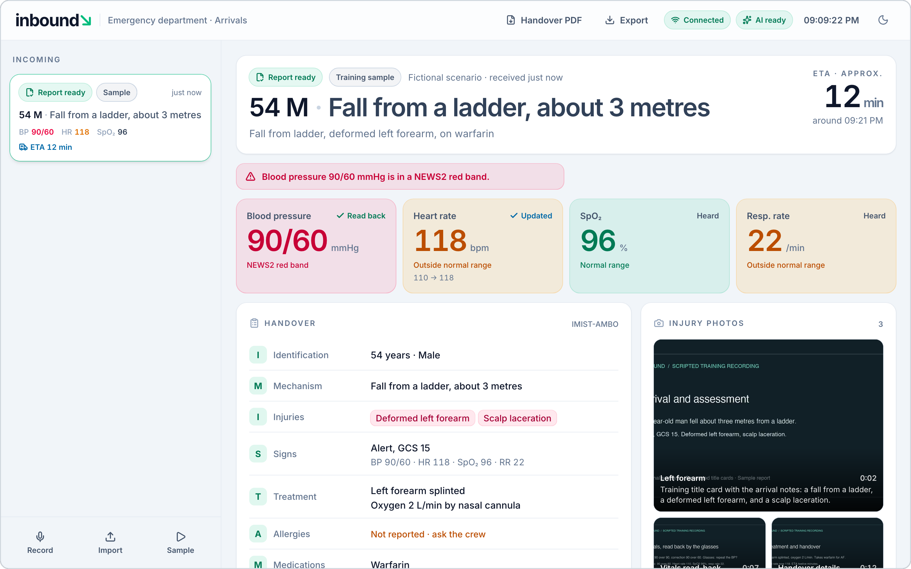
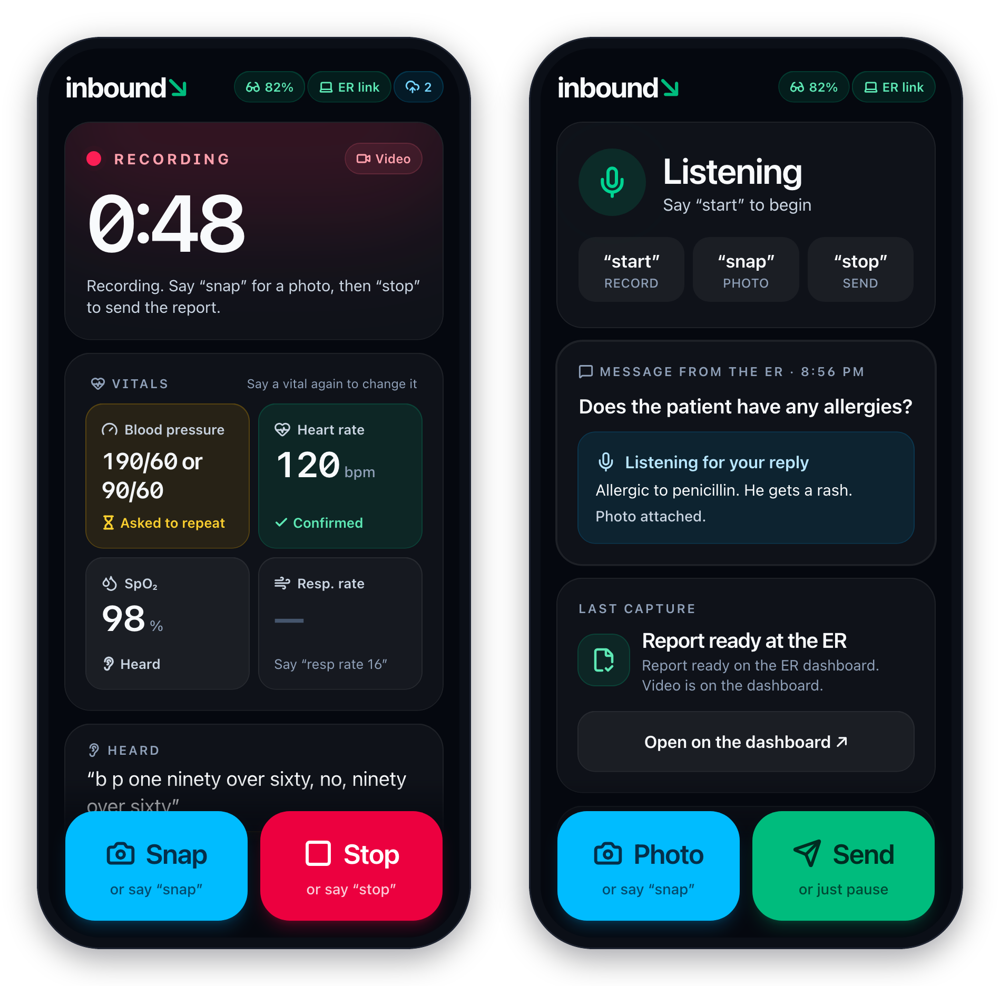
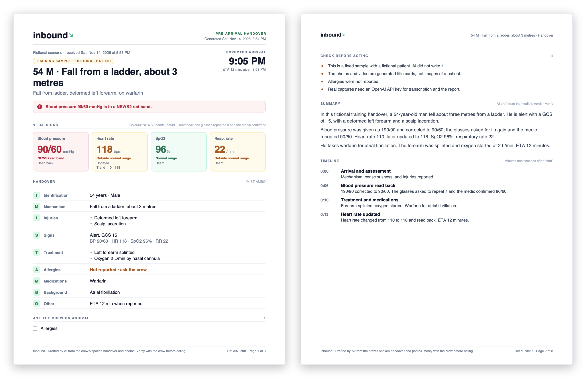
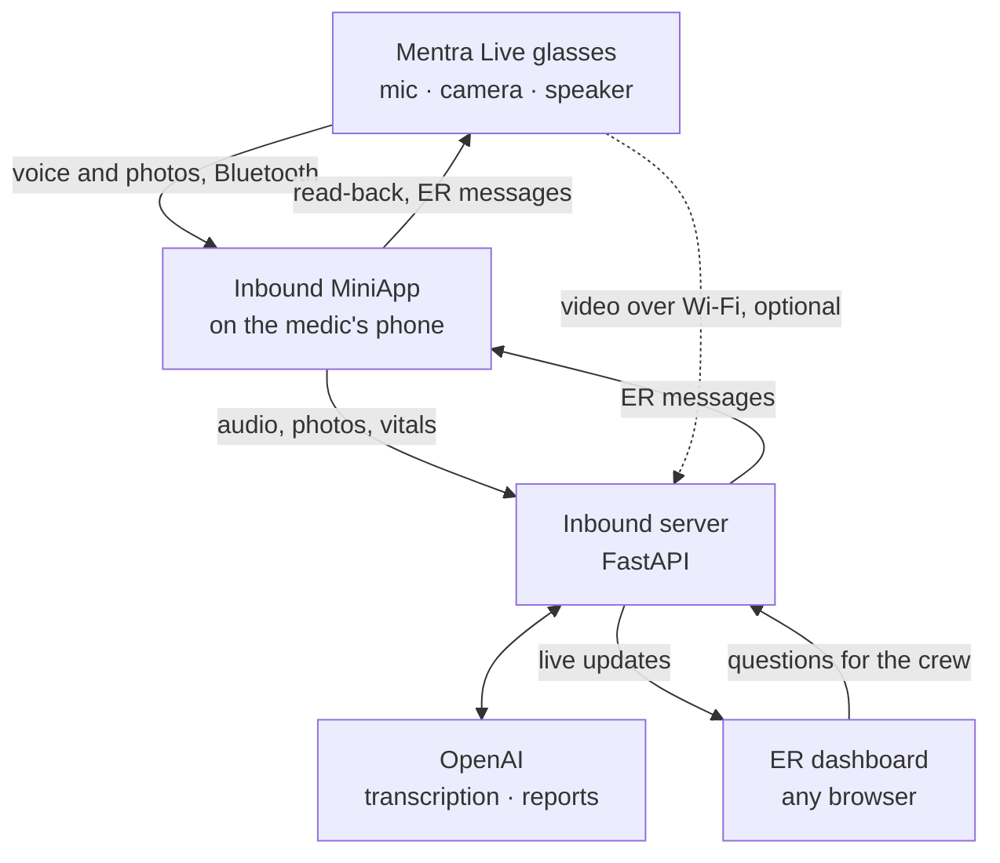
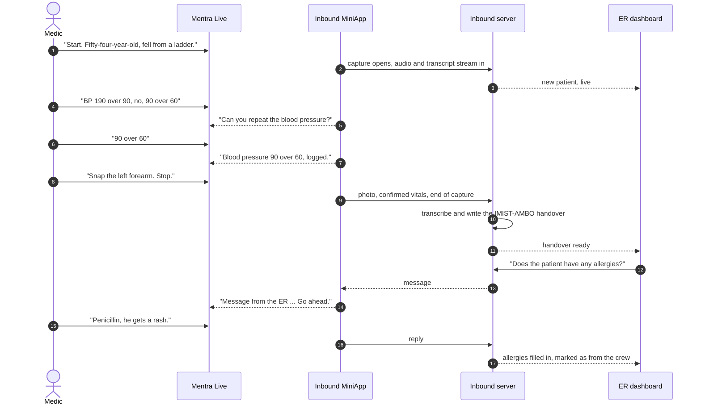

<p align="center">
  <picture>
    <source media="(prefers-color-scheme: dark)" srcset="docs/images/logo-white.png">
    
  </picture>
</p>

<p align="center">
  <strong>Hands-free ambulance-to-ER handover on AI smart glasses.</strong><br>
  The paramedic talks. The glasses double-check the numbers. The ER knows the patient before the doors open.
</p>

<p align="center">
  
  
  
  
</p>

<p align="center">
  <a href="#how-it-works">How it works</a> ·
  <a href="#safety-by-design">Safety by design</a> ·
  <a href="#quick-start">Quick start</a> ·
  <a href="DEVELOPMENT.md">Developer guide</a>
</p>



## The problem

A paramedic loading a patient has gloved hands, a moving ambulance, and no time to type. The emergency department usually learns what is coming from a rushed radio or phone call, and has to guess the rest. The numbers are the dangerous part: "90 over 60" misheard as "190 over 60" changes what the team prepares. Details that matter an hour later, like a blood thinner or an allergy, are easy to lose between the scene and the resus bay.

Inbound lets the paramedic hand over without using their hands, and gives the ER a structured, sourced handover while the ambulance is still on the road.

## What it does

- **Talk, don't type.** The medic says "start", describes the patient, says "snap" to photograph an injury from their own point of view, and says "stop". Commands work in the middle of a sentence: "BP 190 over 90, snap the left forearm".
- **Numbers are double-checked by ear.** Inbound hears blood pressure, heart rate, SpO₂ and respiratory rate as the medic talks. When two values conflict or a number makes no sense, the glasses ask the medic to repeat it and read back the value they log.
- **The ER sees it live.** The dashboard opens the patient as soon as the medic says "start", with the transcript, vitals and photos as they arrive. After "stop", AI writes an IMIST-AMBO handover with NEWS2 colour cues and a source for every statement.
- **The ER can ask, hands-free.** A doctor types or speaks a question. The glasses read it aloud, the medic answers by voice ("snap" adds a photo), and the answer fills in the handover.
- **Paper when it's needed.** One click turns the handover into a PDF to print or attach to the chart.

<p align="center">
  
</p>
<p align="center"><sub>On the medic's phone. Left: mid-handover, the glasses ask the medic to repeat a blood pressure they heard two ways. Right: the medic answers a question from the ER by voice, with a photo.</sub></p>

<p align="center">
  
</p>
<p align="center"><sub>The handover PDF for the fictional sample patient.</sub></p>

## Why glasses

- **Hands stay on the patient.** In an ambulance, voice is the only practical input.
- **Eyes stay on the patient.** Confirmation comes by ear, not from a screen.
- **The camera sees what the medic sees.** "Snap" takes the injury photo from their point of view.
- **No display, by design.** Mentra Live has a microphone, a camera and a speaker. Everything visual lives on the ER dashboard, with the people who need it.

## How it works



- **The phone** ([`app/`](app/)) runs a Mentra MiniApp. On-device speech recognition catches the voice commands and vitals instantly, the glasses' speaker reads values back, and every upload goes through an ordered queue that retries until the server confirms it. If the signal drops, recording carries on.
- **The server** ([`server/`](server/)) stores each capture, joins the audio, transcribes it with OpenAI, and writes the handover with structured outputs, citing the audio, photo or vital behind each statement. It also relays the ER's questions to the phone and turns the medic's replies into handover updates.
- **The dashboard** ([`dashboard/`](dashboard/)) shows every incoming ambulance, soonest first, and the full handover for each patient. It updates live and makes the PDF in the browser.

A handover, end to end:



## Safety by design

- **Numbers are checked, not guessed.** A vital given two different ways, or a number that makes no sense, is asked about again. Changes to a logged vital are read back too, and the dashboard shows which values were confirmed.
- **The confirmed value wins.** The handover uses the read-back value even where the audio transcript disagrees, and lists the discrepancy under **Check before acting**.
- **Every statement has a source.** Each line of the AI summary links to the moment in the audio, the photo, or the vital it came from. AI-written text is labelled as a draft to verify.
- **Alerts only for what's off.** NEWS2 colours highlight abnormal values; they are not a score or a diagnosis. Missing details become a checklist to ask the crew on arrival.
- **Nothing lingers on the phone.** An ER message leaves the phone once it's answered, and closing Inbound ends the conversation. The thread stays on the ER's dashboard.
- **Locked down when hosted.** Online, the phone holds a device token that can only create and upload captures, and the dashboard needs a password. Video through the internet tunnel is accepted only with a per-capture key.

## Quick start

You need a Mac or Linux machine with Python 3 (tested on 3.14) and [Bun](https://bun.sh), the Mentra app on a phone, Mentra Live glasses, and an OpenAI API key. Without a key, captures are still saved, but no handover is written.

```sh
git clone https://github.com/dyauskonai/Inbound.git
cd Inbound
python3 -m venv .venv
.venv/bin/python -m pip install -r requirements-dev.txt
cp .env.example .env                 # add your OPENAI_API_KEY
.venv/bin/python scripts/dev.py --lan
```

In a second terminal:

```sh
cd app
bun install
bun run dev                          # prints a QR code for the Mentra app
```

1. Open the ER dashboard at <http://127.0.0.1:8000/>. No glasses yet? Click **Open a sample patient**.
2. In the Mentra app, connect Mentra Live, then scan the QR code under **Settings → Miniapp Developer Settings**.
3. Say "start", describe the patient, say "snap" for a photo, and say "stop" to send the handover.

The phone must reach the computer on port 8000. Venue Wi-Fi often isolates devices, so a phone hotspot is the reliable choice. To host Inbound online, for ambulances on cellular and an ER in any browser, see [Host it online](DEVELOPMENT.md#host-it-online).

## Repository layout

| Path | Contents |
| --- | --- |
| [`app/`](app/) | Mentra MiniApp for the medic's phone: voice commands, vitals read-back, photos, upload queue, ER messages |
| [`server/`](server/) | FastAPI server: capture storage, media processing, OpenAI transcription and reports, ER messaging |
| [`dashboard/`](dashboard/) | ER dashboard in React. The built copy in `dashboard/dist` is committed, so the server runs without Bun |
| [`scripts/`](scripts/) | `dev.py` runs the server locally, `deploy.sh` sets up a cloud VM, `release_miniapp.sh` builds an installable MiniApp |
| [`deploy/`](deploy/) | VM setup and Caddy configuration for hosting online |
| [`macos/`](macos/) | A small macOS app that starts the server and opens the dashboard |
| [`tests/`](tests/) | Server tests. The MiniApp's tests are in [`app/tests/`](app/tests/) |

## Tech stack

| Layer | Technology |
| --- | --- |
| Glasses | Mentra Live: microphone, camera and speaker, no display |
| Phone | Mentra MiniApp SDK 3.4, TypeScript, React, Tailwind CSS |
| Speech | On-device recognition on the phone for commands and vitals; OpenAI transcription for the full record |
| AI | OpenAI structured outputs for the handover, photo captions, and reading the medic's replies |
| Server | Python, FastAPI, SQLite, ffmpeg, Pillow |
| Dashboard | React 19, Tailwind CSS 4, Lucide icons, jsPDF |
| Hosting | A laptop on the local network, or a cloud VM behind a Cloudflare tunnel or Caddy |

## Testing

```sh
.venv/bin/python -m pytest           # server: capture pipeline, messaging, uploads
cd app && bun test                   # MiniApp: voice commands, vitals parsing, read-back, upload queue
cd dashboard && bun run typecheck    # dashboard types
```

## Roadmap

- **Scan medications and alert bracelets.** Saying "scan" reads a pill bottle or a medical-alert bracelet through the camera, then adds medications, allergies and any blood thinner to the handover.
- **Trauma-criteria alerts.** Flag national field-triage criteria from confirmed vitals, and let the ER confirm a trauma-team activation back to the glasses.
- **Fleet readiness.** Battery, connectivity and app version for every pair of glasses in a service, built to plug into device management platforms such as ManageXR.
- **Production readiness.** Per-user accounts, audit logs, encryption at rest, and data-processing agreements before any real patient data.

## Acknowledgements

- Built at **Immerse the Bay 2026** at Stanford.
- [Mentra](https://mentraglass.com) for Mentra Live and the MiniApp SDK. The MiniApp began from Mentra's starter kit, used under the Apache 2.0 license (see [`licenses/`](licenses/)).
- The handover follows **IMIST-AMBO** (Iedema et al., *BMJ Quality & Safety*, 2012). Vital-sign colours follow **NEWS2** (Royal College of Physicians, 2017).

## License

[MIT](LICENSE) © 2026 Dyaus Konai

> [!IMPORTANT]
> **Not a medical device.** Inbound is a hackathon prototype. It has not been clinically validated, and it does not diagnose or recommend treatment. Use fictional data only. See [DEVELOPMENT.md](DEVELOPMENT.md) for what real patient data would require.
